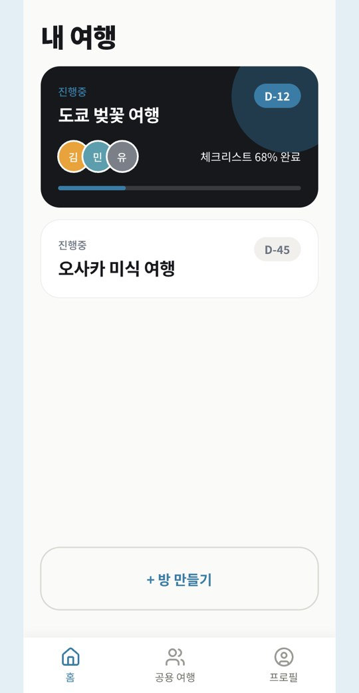
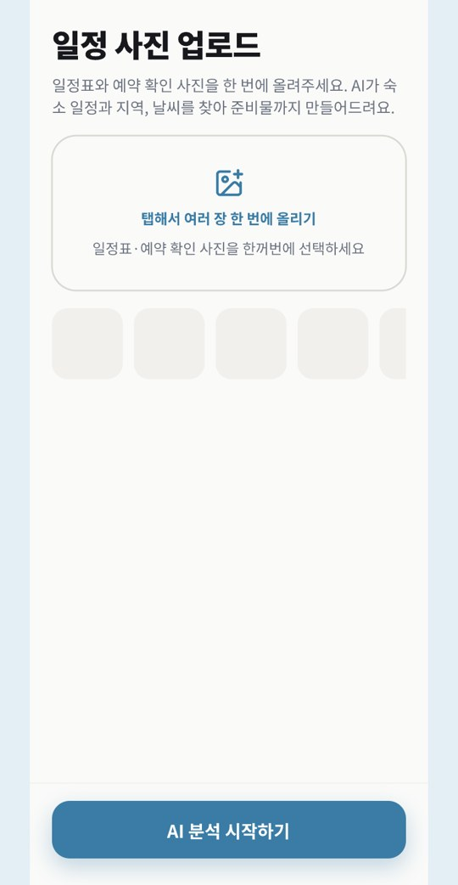
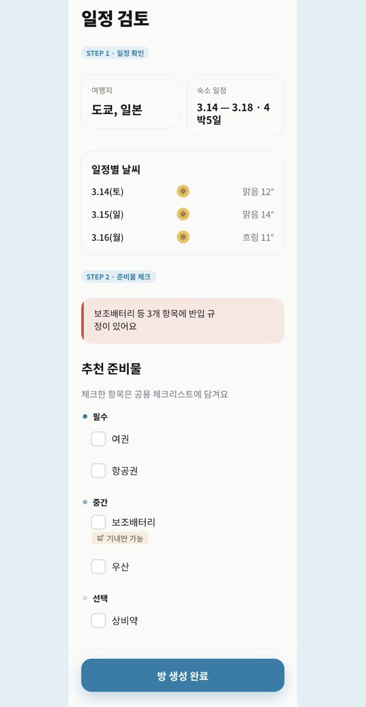
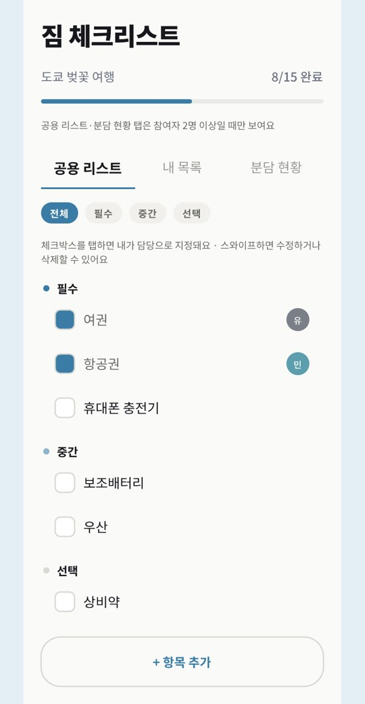

<div align="center">

# 🧳 여행가방 대신 싸줘 (MyBag)

**일정 캡처만 올리면 AI가 준비물을 골라 주고, 동행자와 나눠 챙기는 여행 앱**

<sub>4인 팀 프로젝트 · 팀장 · 서버 담당 · 2026.08 출시</sub>

<br/><br/>

<a href="https://play.google.com/store/apps/details?id=com.mybagteam.mybag"></a>
<a href="https://github.com/Ju-unn/mybagbackend"></a>

<br/><br/>

&nbsp;
&nbsp;
&nbsp;


<sub>내 여행 · 일정 사진 올리기 · 일정 검토 · 짐 체크리스트</sub>

</div>

<br/>

## 왜 만들었나

여행을 갈 때마다 항공 반입 규정, 준비물, 날씨를 하나씩 찾느라 시간이 많이 들었어요. 동행자가 있으면 누가 무엇을 챙길지 정하는 것도 일이었고요.

그래서 **일정표와 예약 캡처만 올리면 AI가 준비물을 골라 주고, 동행자와 나눠 챙기는 앱**을 4인 팀으로 만들어 출시했습니다.

## 어떻게 쓰나

```
일정 · 예약 캡처 올리기 → AI 분석 → 일정 검토 → 준비물 고르기 → 동행자와 나눠 챙기기
```

- 일정표와 숙소 · 항공 예약 화면을 **여러 장 한 번에** 올려요.
- AI가 여행지, 날짜, 숙소를 읽고, 그 기간의 **실제 날씨 예보**와 **항공 반입 규정**을 붙여 준비물을 추천해요.
- 고른 준비물은 **공용 체크리스트**가 되고, 동행자마다 담당을 정해 함께 챙겨요.
- 출발 D-7 · D-3 · D-1에 알림이 와요.

## 내가 한 것

서버를 맡은 **팀장**으로 역할과 규칙을 먼저 합의하고, 모든 화면이 같은 데이터를 보게 했어요.

- **서버 전체를 혼자 만들었어요.** (PHP 8 · MySQL · AWS EC2)
  - API 30개, 테이블 12개, 예약 작업(cron) 3개
  - 서버 저장소 커밋 60개 모두 직접 작성
- **같은 체크리스트 보장**: 원래는 고른 물품을 휴대폰 앱 안에서 각자 걸러서, 방장 · 팀원 · 나갔다 다시 들어온 팀원의 목록이 달랐어요. 서버가 고른 물품만 저장하게 바꿔 **먼저 배포한 뒤** 앱의 필터를 지웠어요.
- **서버가 최종 검증**: 방장 권한은 버튼 숨기기로만 막혀 있었어요. 방장이 아니면 서버가 HTTP 403으로 거절하게 했어요. 여행방 참여는 행을 잠가(`FOR UPDATE`) 정원을 넘지 않게 했어요.
- **흔들리던 AI 판정 고정**: 보조배터리 같은 반입 위험물 판정이 호출할 때마다 달라졌어요. 공식 안내를 바탕으로 정한 **15개 목록 안에서만** AI가 고르게 하고, 판정 문구는 서버가 채웠어요.
- **날씨는 AI 대신 실제 예보**로 채웠어요. AI가 지어낼 수 있는 값은 맡기지 않았어요.
- 안드로이드 앱에서는 여행 · 체크리스트 · 날씨 데이터 계층을 맡았고, PR 33개를 올려 31개가 병합됐어요.

<br/>

 -3DDC84?style=flat-square&logo=android&logoColor=white)        

## 더 알아보기

- 📐 [시스템 구조](docs/구조.md)
- 📘 [개발 문서 (기능 · API 선정 · 비용 · 패키지 구조 · DB)](docs/개발문서.md)
- 📦 [UI 패키지 구조](docs/ui-package-structure.md)
- 🗄️ [서버 저장소와 API 명세](https://github.com/Ju-unn/mybagbackend/blob/main/APIs.md)

---

<sub>만든 사람 [@Ju-unn](https://github.com/Ju-unn) 외 3명</sub>
