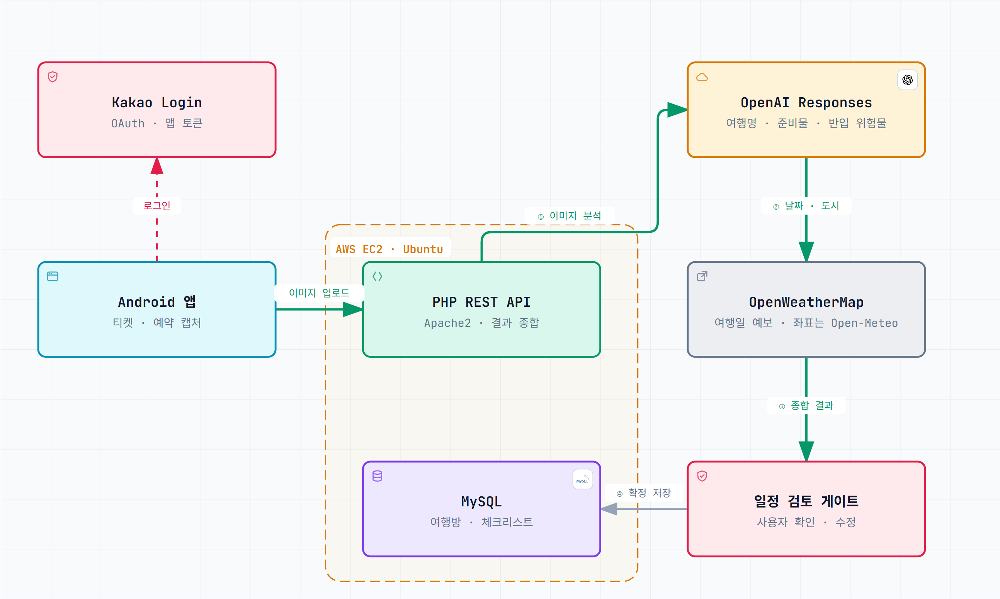

# MyBag 구조

[← README로 돌아가기](../README.md)

## 시스템 구조

| 순서 | 흐름 |
|---|---|
| 로그인 | Android 앱 → Kakao Login (OAuth) → 서버가 앱 토큰 발급 |
| ① 이미지 분석 | 앱이 일정 · 예약 캡처를 올리면 PHP 서버가 OpenAI Responses API로 여행명, 준비물, 반입 위험물을 받아요 |
| ② 날짜 · 도시 | 분석된 도시와 날짜로 OpenWeatherMap 예보를 가져와요(도시 좌표는 Open-Meteo) |
| ③ 종합 결과 | 분석과 날씨를 합쳐 일정 검토 화면으로 보내요 |
| ④ 확정 저장 | 사용자가 확인 · 수정한 뒤에만 MySQL에 여행방과 체크리스트로 저장해요 |

## 서버 (PHP 8 · MySQL · AWS EC2)

- API 30개: 파일 기반 엔드포인트(`html/api/도메인/동작.php`)
- 테이블 12개: users, trips, trip_members, trip_invites, trip_uploads, ai_analyses, packing_items, user_default_items, notification_settings, fcm_tokens, api_cache, notification_log
- 예약 작업 3개: 출발 알림(D-7 · D-3 · D-1), 고아 데이터 정리, 탈퇴 회원 정리
- 자세한 명세: [APIs.md](https://github.com/Ju-unn/mybagbackend/blob/main/APIs.md) · [SCHEMA.md](https://github.com/Ju-unn/mybagbackend/blob/main/SCHEMA.md)

## 팀 규칙

4명이 데이터를 각자 해석하면 화면마다 결과가 달라져요. 그래서 역할을 먼저 나눴어요.

- **앱**: 화면과 입력
- **서버(팀장)**: 권한, 정원, 데이터 무결성
- **공지**: 12시간 안에 확인
- **서버와 앱을 함께 바꿀 때**: 배포 순서까지 합의한다. 예: 서버를 먼저 배포하고 앱 필터를 나중에 지운다.

## 더 자세한 설계

- [개발 문서](개발문서.md): 개발 전에 쓴 설계 문서예요. 기능, API 선정 이유, 예상 비용, 패키지 구조, DB 설계가 있어요.
- [UI 패키지 구조](ui-package-structure.md)
